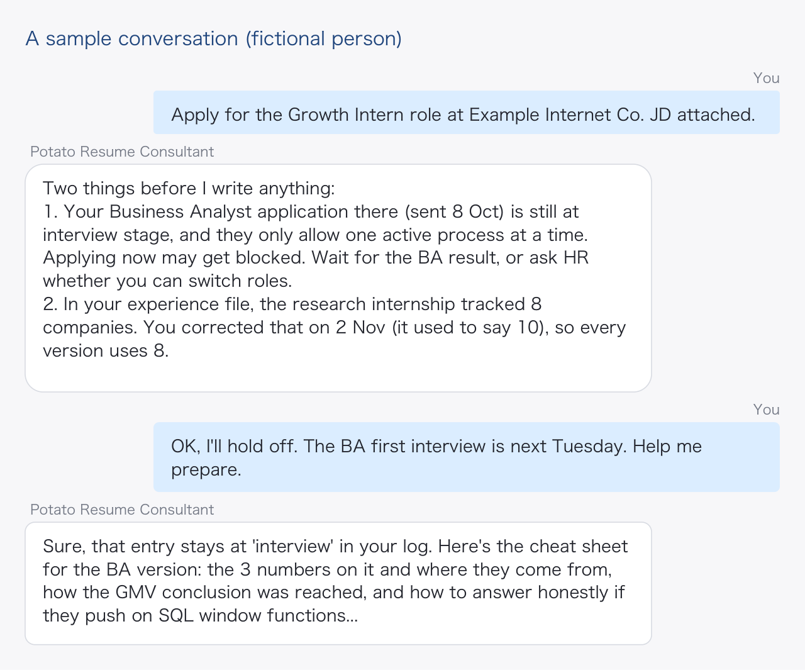
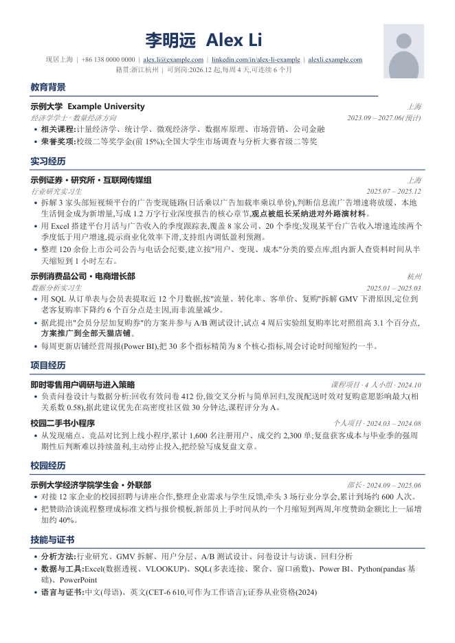
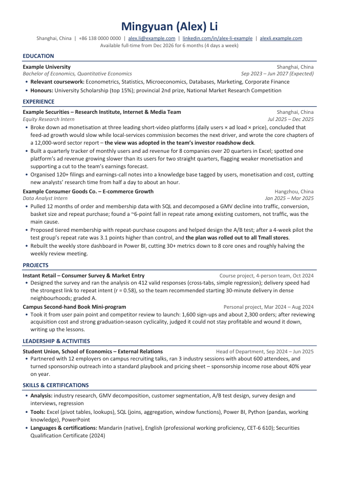

# Potato Resume Consultant · Turn your AI into your own career consultant

English · [中文](README.md)

Using AI on your resume usually means explaining who you are all over again, getting back vague filler, and sometimes a number it simply made up, which falls apart the first time an interviewer asks about it. Paid career coaching costs a lot, and a coach juggling many clients may not remember the details of every role you've had. This skill takes a different route: build your experience file once, and the AI you already use becomes a consultant that works only for you and knows you better every time.

> I'm a university student looking for internships, and I've tailored more than 50 resumes with this process. I once built an AI resume website, then realised I didn't use it myself: it started from zero every time and never remembered who I was. So I built this instead.

Works with Claude, ChatGPT / Codex, Cursor, GitHub Copilot, Gemini CLI and more, on Windows, macOS and Linux. To [install](#install), send one sentence to your AI; once installed, the skill is called `resume-tailor`, and "use Potato Resume Consultant" or "use resume-tailor" both work.

> 🩺 **Start with a free resume check-up**: nothing else to install and no file to build. Say "check up this resume" and send a resume plus the JD. You get a one-page report on how an interviewer would probe each line, where you risk overstating, and which JD keywords are missing.

## One experience, written for two different jobs

A real entry from your experience file (fictional example): *intern in a brokerage research team covering internet and media; tracked monthly users and ad revenue for 8 platforms over 20 quarters; wrote one chapter of a short-video advertising report.*

| | Bullet |
|---|---|
| ❌ Typical AI | Responsible for industry research, assisted with industry reports, supported team decision-making and greatly improved efficiency. |
| ✅ For equity research / banking | Built a tracker of monthly users and ad revenue for 8 platforms over 20 quarters; flagged one platform whose ad revenue grew slower than its user base for two straight quarters, supporting the team's cut to its earnings forecast. |
| ✅ For tech strategy / business analysis | Broke down short-video ad monetisation (DAU × ad load × price); concluded feed-ad growth would slow and local-services commission would be the next driver, a view the team lead adopted for client roadshow materials. |

Both versions use the same real numbers and conclusions; only the logic changes to what each industry values: research cares about **calls and forecasts**, tech cares about **monetisation and growth**. If a number or conclusion isn't in your bank, it asks you instead of making one up.

## A consultant, not a tool

**It remembers you.** Your experience file lives on your own computer: which roles can go on a resume, which only in a certain way, which never, and every number you've corrected. Start a new conversation and you don't have to explain yourself again. The first session takes a few more questions; after that it gets faster.

**It judges before it writes.** Every JD starts with an eligibility check: graduation year, location, start date, visa, and any application rules at that company. Then it picks your strongest experiences from everything you've done and writes them the way that industry thinks. If you don't qualify, or the odds look poor, it tells you plainly.

**It keeps you honest.** No invented experience, no invented numbers. Every line is broken into the questions an interviewer would ask: did you lead it or take part? Is that number the team's or yours? Did it launch, or is it still a plan? Anything that wouldn't survive the question gets rewritten until it would.

**It stays with you for the whole season.** Each application goes into a log: the company, the resume version you sent, where it stands, and any rules that company has. Say "X invited me to interview" in a conversation where you're using it, and it updates the log; apply to the same company again and it warns you first. Once you've carefully tailored one version for a direction, similar roles can go through quick mode, so each application is faster than the last.

### Where it can remember you

"It remembers you" depends on your three files surviving between conversations, so it depends on which AI you use:

| Your AI | Makes the Word / PDF itself | Remembers you in a new conversation |
|---|---|---|
| Local agents: Claude Code, Codex, Cursor, Copilot, Gemini CLI and similar | ✅ | ✅ Your files live on your own computer |
| WorkBuddy | ✅ | ✅ Your files live on your own computer (still being confirmed) |
| Claude.ai, ChatGPT web / app | ✅ In its sandbox | ⚠️ Sandboxes usually don't keep files between conversations. Download the updated files at the end of each conversation (it sends them to you) and send them back at the start of the next; or pack `materials.md` into the zip you upload |
| Chat-only AI that can't run commands | ❌ Paste the text into the template in `assets/` yourself | ❌ Send `materials.md` at the start of every conversation |
## Compared with a regular AI chat and paid career coaching

| | Regular AI chat | Paid career coaching | This skill |
|---|---|---|---|
| Cost | Depends on the AI; some are free | Often a lot | The skill is free and open source; you use the AI you already have |
| Knows your full background | Only what you paste this time | Depends on the coach's bandwidth | Your file holds every experience, red line and correction |
| Available whenever you need it | Yes | At booked times | Yes, even at 2 a.m. |
| Makes things up | Tends to invent missing numbers | Usually not | No; every line is checked against likely interview questions |
| Re-explaining yourself for a new role | Every new chat | Usually not | No; it reads your file first |
| Tells you whether a role is worth it | Usually just starts writing | Yes, with industry experience | Checks eligibility and picks experiences first, and says so if it's a poor fit |

Career coaching does offer things this skill can't: a real person's industry experience, a network, and referrals. If you need those, coaching is worth considering; this skill makes sure your resume and applications are solid.

## What else it does

- **List now, learn fast**: JD skills you can pick up in a day to a week go on the resume, worded honestly ("familiar with", never "expert"), with a crash-course plan when you ask: learning route, practice project and likely interview questions.
- **One full page that gets past the screen**: a fixed template in Word and PDF, no overflow and no empty space at the bottom; before delivery it checks section headings, font sizes, margins, whether the PDF text reads correctly, and JD keyword coverage.
- **Interview cheat sheet**: got an interview? Ask, and you get the numbers in that version, where they come from, how each conclusion was reached, and how to answer honestly about new skills.
- **Form-ready plain text**: filling in an online form? Ask, and you get your details laid out by the usual fields (Workday, company career sites and so on), with consistent dates, ready to paste.
- **Quick mode**: once you've carefully tailored one version for a direction, say "quick mode" and it builds straight away, explaining its choices at delivery.

The finished resume looks like this:

  
  

Fictional person: every school, company and number is made up.

## Install

### ⚡ Easiest: send this to your AI (recommended)

For AIs that can run commands on your computer: Claude Code, Codex, Cursor, GitHub Copilot, Gemini CLI and others.

> Install this skill for me: https://github.com/Potatokid830/ultimate-resumetailor. Download it into your skills folder as a folder named resume-tailor, install whatever it needs, then tailor my resume to the JD I'm sending you.

It downloads the skill, puts it in the right place, installs Python and a PDF converter (asking you first), and starts on your resume for that JD, asking about your experience as it goes.

### Manual install

1. Click the green **Code → Download ZIP** button above, unzip it, and rename the folder to `resume-tailor`.
2. Give the folder to your AI:
   - **Claude.ai / Claude desktop**: upload the zip under Settings → Capabilities → Skills. For ChatGPT and other apps, follow that app's "Setup instructions" on the [client list](https://agentskills.io/clients).
   - **Claude Code, Codex, Copilot, Cursor, Gemini CLI and other coding agents**: put the folder in the agent's skills folder. For Claude Code that is `~/.claude/skills/` (on Windows, `C:\Users\<you>\.claude\skills\`); many agents also read the shared location `~/.agents/skills/`.
   - **Any other AI** without skill support: put the folder somewhere it can read and say "Read `resume-tailor/SKILL.md` and follow it to tailor my resume".
3. Say: "Use resume-tailor to tailor my resume."

### First use: no blank template to fill in

If you bring a JD on first use, the AI checks your eligibility first (graduation year, location, start date, visa) so you don't set everything up for a role you can't apply to. Then it checks what your computer is missing (Python, plus Word, WPS or LibreOffice to make the PDF) and installs it with your permission. Then just **send it everything you have**: old resumes (however rough), your LinkedIn, internship reports, coursework, project documents. It reads everything and turns it into a draft experience file. If you came with a JD, you only confirm the items that JD needs (usually no more than 10); the rest are saved as "to confirm" and asked about when a later JD needs them. Only if you just want to build the bank does it go through every item. If you only want a check-up first, you can skip this. If it has memory, it also pulls in what you've already told it, for you to confirm. You don't need to type any commands yourself.

> Producing the docx / pdf requires an AI that can run commands on your computer (or in its own sandbox). A chat-only AI can still run the whole process (eligibility check, selection, rewriting, recruiter critique, cheat sheet, form text); you then paste the text into the blank template in `assets/` yourself.

## Supported AI tools

Any agent that supports the open [Agent Skills](https://agentskills.io) format (a folder with `SKILL.md` and scripts) can use it. According to the [official client list](https://agentskills.io/clients), that includes:

- **Claude**: Claude.ai, Claude desktop, Claude Code
- **OpenAI**: ChatGPT, Codex
- **GitHub Copilot / VS Code**
- **Coding agents**: Cursor, TRAE, Kiro, Roo Code, JetBrains Junie, Amp, OpenCode, Goose, OpenHands, Factory, Tabnine and more
- **Others**: Google Gemini CLI, Mistral Vibe, Letta, OpenClaw

The list keeps growing; check the website for the latest. Agents without skill support can still use it (see "Any other AI" under Manual install).

## Updating to a new version

Easiest: ask your AI

> Update the resume-tailor skill to the latest version from https://github.com/Potatokid830/ultimate-resumetailor, and keep my profile.json, materials.md and photo.

Updating by hand

To update by hand, follow the way you installed it:

- **Downloaded the ZIP into a skills folder** (Claude Code, Codex, Cursor and so on): download and unzip the new ZIP, then copy the new files into your existing `resume-tailor` folder, overwriting files with the same name. The new ZIP doesn't contain `profile.json`, `materials.md` or your photo, so overwriting is safe. **Don't delete the old folder first**, or your personal files go with it.
- **Cloned with git**: run `git pull` inside the skill folder. Your personal files aren't tracked by git, so they stay untouched.
- **Uploaded the zip in Claude.ai / desktop settings**: remove the old version under Settings → Capabilities → Skills and upload the new zip. If you had packed `materials.md` into your zip, add it to the new zip before uploading.

New versions keep using your existing `profile.json` and `materials.md`; you don't need to fill them in again.

## How a session goes

Say "Use resume-tailor to tailor my resume for this JD" and paste the job description. There are three modes:

- **🩺 Resume check-up**: say "check up this resume" and send an existing resume (ideally with the JD). No experience file and no rewriting: you get a one-page report with an overall verdict and the top 3 fixes; how many claims were found and how many hold up, need preparation or risk overstating; JD keyword coverage; and, line by line, how an interviewer would probe it and how to fix it. The report leaves out your contact details and can swap company and school names for generic ones if you want to share a screenshot. Facts you confirm during the check-up become the first draft of your experience file.
- **Polish mode** (default): for the first application in a direction or a company you really want. It asks you about selection and missing details first.
- **⚡ Quick mode**: say "quick mode", "mass apply" or "just build it", or paste several JDs at once. It skips waiting for your OK on selection, builds from your bank, and explains its choices at delivery. It only uses items you marked ✅, never invents numbers and never adds new skills you haven't approved; the eligibility check still runs, and any JD that fails it is paused for you. The first application in a new direction goes through polish mode so you can confirm the selection; once it is saved in your bank, later roles in that direction go straight through. With several JDs, each gets its own folder, the chat shows one summary table, and you ask for whichever cheat sheets or form text you need.

The full process:

1. **Checks eligibility**: graduation year, location, start date and duration, visa, GPA cut-offs, application limits, plus your application log: any process already running at this company, or a cooling-off period. Anything that fails is raised first.
2. **Reviews your whole experience file** in `materials.md` and picks what fits the JD best. It reads everything but only asks about unconfirmed items this JD needs. If your AI has memory, it also checks memory for experiences, numbers or corrections the bank is missing; the ones this JD needs go to you for confirmation, the rest are saved as "to confirm".
3. **Asks before writing**: lists what goes in, the angle for each item, and what stays out and why, then waits for your OK (skipped in quick mode).
4. **Asks for missing details**: numbers and feedback only you know; it never guesses (in quick mode it leaves them out and lists them at delivery).
5. **Aligns skills with the JD**: adds skills you can learn quickly; ask for a crash-course plan when you want one.
6. **Writes and reviews the text first**: a plain-text draft goes through the claim-by-claim audit (each bullet split into checkable claims, matched to your bank, anything overstated fixed) and a recruiter critique; if you gave it an old resume, the two are compared side by side and the new one must not be worse on any point. Layout only starts once the text is final, so the page isn't squeezed again and again.
7. **Lays it out + ATS self-check**: one full page, docx + pdf; `ats_check.py` checks section headings, contact details, font sizes, margins, tables/text boxes, document properties, PDF text extraction, empty space at the bottom, typos such as "Al" for "AI", and JD keyword coverage.
8. **Delivers** (and logs the application in `applications.md`; later, in a conversation where you're using it, say "X invited me to interview" or "X rejected me" and it updates the status):
   - By default: docx + pdf, plus a short delivery table: what was included, what was left out, which skills to learn, the ATS result, and an honest view of your interview chances
   - On request (say "I'm applying", "I need to fill in the form" or "I got an interview"):
     - **Interview cheat sheet**: every number in this version and its basis, how each conclusion was reached, honest answers for "list now, learn fast" skills, and how this version differs from your others
     - **Form-ready plain text**: education, experience, projects and skills laid out by the usual form fields, dates as `2025-07`, no bullets or bold, ready to paste
     - **Crash-course plan**: learning route, practice project and likely interview questions for each "list now, learn fast" skill
   - Anything generated on request is saved next to the resume as `<file name>.notes.md`, so you can pull it up when an interviewer calls

## Your data

- **Where it lives**: your files (`profile.json` for your details, `materials.md` for your experiences, `applications.md` for your applications), your photo, every generated resume, the `.notes.md` files and check-up reports stay on your own computer (or in your AI's sandbox). They are all in `.gitignore`, so they are never committed to GitHub.
- **Your conversations**: the resume, experiences and JDs you send are handled under the privacy policy of the AI service you use (Claude, ChatGPT, Codex, WorkBuddy and so on). This skill has no control over how a platform stores conversations, so check its policy if that matters to you.
- Keep personal content out of `SKILL.md`, so the skill itself can be updated and shared safely.

## Folder structure

See the [directory tree](README.md#目录结构) (comments in Chinese): `SKILL.md` (the workflow), `profile.example.json`, `materials.example.md` and `applications.example.md` (templates you copy), `assets/` (blank Chinese and English templates), `scripts/` (build, ATS check, PDF export), `examples/` (fictional sample builds), plus `tests/` and `tools/` for maintainers.

## License

[MIT](LICENSE)
