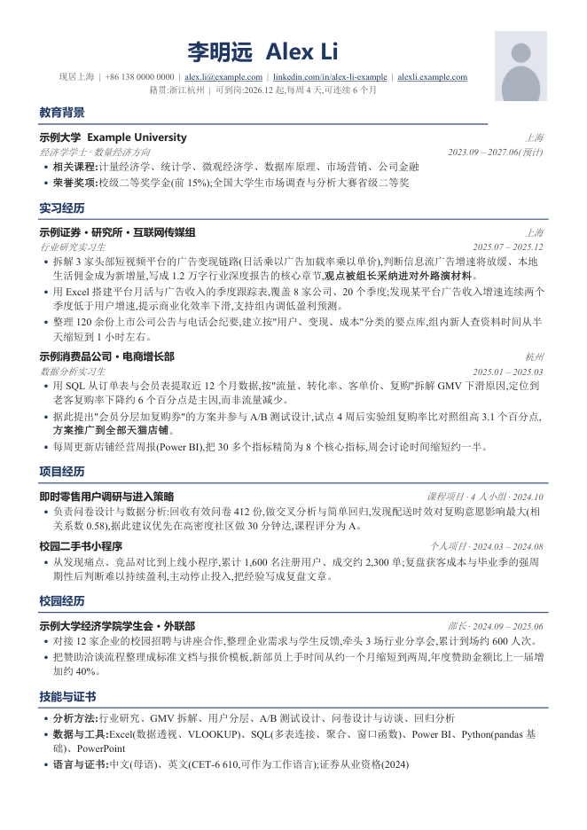

# resume-tailor · 按 JD 定制一页简历的 AI Skill

[English](#english) · 中文

**海投几十家没回音？用 AI 改简历，满篇"赋能、抓手"，面试一问就露馅？**

把 JD 丢给它：它从你**全部的真实经历**里重新挑材料，用目标行业的语言重写，做成**刚好一页**的 Word + PDF，交付前先过一遍机筛（ATS / AI 筛简历）自检和 HR 挑刺。每一版还附**面试速查卡**和**网申纯文本**，投完不忘写过什么，填网申表直接复制。

`不编造` · `一页写满` · `按行业翻译经历` · `先写后学 + 速成清单` · `机筛自检 + HR 挑刺` · `⚡ 快投模式` · `🩺 简历体检`

**不想先建素材库？** 对 AI 说"帮我体检这份简历"，发一份现成简历和 JD，就能拿到一页体检报告：每句话会被面试官怎么追问、哪里有夸大风险、JD 关键词漏了哪些。

Claude、ChatGPT / Codex、Cursor、GitHub Copilot、Gemini CLI 等都能用，Windows、macOS、Linux 都支持，[安装](#安装)只要把一句话发给你的 AI。

<p align="center">
  
  
</p>
<p align="center"><sub>示例简历里的人物、学校、公司、数字都是虚构的。</sub></p>

## 和"让 AI 帮我改简历"有什么不一样

| ❌ 普通 AI 改简历 | ✅ resume-tailor |
|---|---|
| 只看你这次贴进来的那版简历 | 先把你的**全部经历素材库**过一遍，按 JD 重新选材；AI 有记忆时，会把记忆里的新经历经你确认后补进素材库 |
| 拿到就写，缺数字就编一个 | **先问再写**：先列"放什么、不放什么、为什么"，你确认后才动手；缺细节就追问，不猜 |
| 润色措辞，"负责""协助""参与" | **按目标行业翻译经历**：分析 → 判断 → 建议 → 结果，用券商 / 互联网 / 咨询各自的语言写（见下面的例子） |
| 要么不敢写 JD 技能，要么乱写"精通" | **先写后学**：只写 1 天到 1 周能上手的技能，用词实诚，并附**速成清单**（学习路线、练手项目、面试题） |
| 包装和编造没有边界 | 明确的**红线**：GPA、经历、结果、证书必须真实；你标过 ❌ 的内容任何版本都不写 |
| 不在乎排版 | 固定模版，**一页写满**，不溢出、不留白 |
| 交付就结束 | 先查**资格**（届别、地点、到岗时间、签证），交付前跑 **ATS 自检** + **JD 关键词覆盖**，再站在 HR 角度挑刺 |
| 投了十几个版本，面试时忘了这家写的是什么 | 每版附**面试速查卡**：写了哪些数字、依据是什么、结论怎么来的、新技能怎么答 |
| 网申还要一格一格从 PDF 里复制 | 每版附**网申纯文本**：按北森、Moka、Workday 等表单的字段排好，日期统一，直接粘贴 |
| 只说"写得不错"，不告诉你哪句会被追问穿帮 | **逐句拆解核查**：每句话拆成能核实的小问题（主导还是参与？团队的数字还是个人的？已经上线还是还在规划？），对照 6 类常见夸大逐个标出风险，尽量交给没参与写作的独立审稿代理来审 |
| 每投一家都要聊好几轮 | **⚡ 快投模式**：同方向已经精修过一版后，说"快投"就直接出稿，取舍在交付时说明 |

## 同一段经历，投不同岗位怎么写

素材库里的一段真实经历（虚构示例）：*在券商研究所互联网传媒组实习，跟踪 8 家平台 20 个季度的月活和广告收入，写了短视频广告行业报告的一章。*

| | 写法 |
|---|---|
| ❌ 普通 AI | 负责行业研究工作，协助撰写行业报告，赋能团队决策，大幅提升工作效率。 |
| ✅ 投券商 / 投研 | 搭建 8 家平台、20 个季度的月活与广告收入跟踪表，发现某平台广告收入增速连续两个季度低于用户增速，提示商业化效率下滑，支持组内调低盈利预测。 |
| ✅ 投互联网商分 / 战略 | 拆解短视频平台广告变现链路（日活 × 广告加载率 × 单价），判断信息流广告增速将放缓、本地生活佣金成为新增量，观点被组长采纳进对外路演材料。 |

两版的数字和结论都来自同一段经历的真实细节，只是换成了对方行业看重的逻辑：券商看**判断和预测**，互联网看**变现和增长**。素材库里没有的数字和结论，它会先问你，不会替你编。

## 安装

### ⚡ 最省事：把这句话发给你的 AI（推荐）

适用于能在你电脑上运行命令的 AI：Claude Code、Codex、Cursor、GitHub Copilot、Gemini CLI 等。

> 帮我安装这个 skill：https://github.com/Potatokid830/ultimate-resumetailor 。把它下载到你的 skills 文件夹里，文件夹命名为 resume-tailor，装好它需要的依赖，然后用它帮我建简历素材库。

它会自己下载、放到正确的位置、装好 Python 和 PDF 转换工具（装之前会问你），然后开始帮你建素材库。

### 手动安装

1. 点页面上方绿色的 **Code → Download ZIP**，下载后解压，把文件夹名改成 `resume-tailor`。
2. 把文件夹交给你用的 AI：
   - **Claude.ai / Claude 桌面版**：在 Settings → Capabilities → Skills 上传这个 zip。ChatGPT 等其他应用按 [agentskills.io 名单](https://agentskills.io/clients) 里该应用的 "Setup instructions" 操作。
   - **Claude Code、Codex、Copilot、Cursor、Gemini CLI 等编程工具**：放进它的 skills 文件夹。Claude Code 是 `~/.claude/skills/`（Windows 上是 `C:\Users\你的用户名\.claude\skills\`）；很多工具也认通用位置 `~/.agents/skills/`；各工具的具体位置见 [agentskills.io 名单](https://agentskills.io/clients) 里的 "Setup instructions"。
   - **其他 AI**（不支持 skill 的）：把文件夹放在 AI 能读到的地方，对它说"读 `resume-tailor/SKILL.md`，按里面的流程帮我改简历"。
3. 对 AI 说："用 resume-tailor 帮我改简历"。

### 第一次用：不用对着空白模版填

第一次使用时，AI 会检查你的电脑还缺什么（Python，以及 Word / WPS / LibreOffice 其中一个用来转 PDF），征得你同意后帮你装好。然后你只要**把手头的材料一股脑发给它**：旧简历（写得再烂也行）、LinkedIn、实习周报、课程报告、项目文档。它会全部读一遍、拆成素材库初稿。你带着 JD 来的话，它只让你确认这份 JD 要用的那几条（一般不超过 10 条），其余先标成"待确认"存着，等哪份 JD 用到再问你；只想建库的话才逐条确认。只想先体检一份简历的话，这一步可以跳过。如果它有记忆功能，还会把记忆里你提过的经历一起整理进来给你确认。你不需要自己敲任何命令。

> 出 docx / pdf 需要 AI 能在你电脑上（或它自己的沙盒里）运行命令。只能聊天、不能运行命令的 AI 也能走完整个流程（资格核查、选材、改写、HR 挑刺、速查卡、网申纯文本），只是最后要你自己把文字贴进 `assets/` 里的空白模版。

## 支持哪些 AI 工具

这个 skill 用的是 [Agent Skills](https://agentskills.io) 开放格式（一个文件夹，里面有 `SKILL.md` 和脚本），不只 Claude 能用。按 [agentskills.io 官方名单](https://agentskills.io/clients)，支持这个格式的常见工具有：

- **Claude**：Claude.ai、Claude 桌面版、Claude Code
- **OpenAI**：ChatGPT、Codex
- **GitHub Copilot / VS Code**
- **编程工具**：Cursor、TRAE、Kiro、Roo Code、JetBrains Junie、Amp、OpenCode、Goose、OpenHands、Factory、Tabnine 等
- **Google Gemini CLI**、**Mistral Vibe**、**Letta**、**OpenClaw**

名单在持续增加，以官网为准。不在名单上的 AI 也能用，见上面手动安装里的"其他 AI"。

## 更新到新版本

最简单：直接对你的 AI 说

> 帮我把 resume-tailor 这个 skill 更新到 https://github.com/Potatokid830/ultimate-resumetailor 的最新版，保留我的 profile.json、materials.md 和照片。

自己更新的话，按当初的安装方式：

- **下载 ZIP 放进文件夹的**（Claude Code、Codex、Cursor 等）：重新 **Code → Download ZIP** 并解压，把新文件复制进旧的 `resume-tailor` 文件夹、覆盖同名文件。新压缩包里不含 `profile.json`、`materials.md` 和照片，所以覆盖是安全的；**不要先删掉整个旧文件夹**，否则个人文件会一起丢。
- **用 git clone 下载的**：在 skill 文件夹里运行 `git pull`。个人文件不受 git 管理，不会被动到。
- **在 Claude.ai / 桌面版设置里上传 zip 的**：在 Settings → Capabilities → Skills 里删掉旧版，重新上传新 zip。如果当初把 `materials.md` 打包进了 zip，上传前先把它放进新 zip。

新版本会沿用你原来的 `profile.json` 和 `materials.md`，不需要重新填。

## 使用流程

对 AI 说："用 resume-tailor 帮我按这个 JD 改简历"，并贴上 JD。有三种模式：

- **🩺 简历体检**：说"帮我体检这份简历"，发一份现成简历（最好带上 JD）。不用建素材库，也不改写，直接给一页体检报告：总评和最该先改的 3 件事；拆出多少个主张、几个站得住、几个要准备、几个有夸大风险；JD 关键词覆盖率；逐条写出面试官会怎么追问、建议怎么改。报告里不写你的联系方式，要截图分享时还可以把公司和学校名换成泛称。体检时你确认过的事实，以后直接作为素材库初稿。
- **精修模式**（默认）：第一次投某个方向、冲刺最想去的公司时用。选材和缺的细节都会先问你。
- **⚡ 快投模式**：说"快投""海投""直接出稿"，或一次贴好几个 JD。不再等你确认选材，直接按素材库出稿，交付时说明自动做了哪些取舍。它只用你标了 ✅ 的内容，不编数字、不加你没同意过的新技能；资格核查照做，不过的会单独停下来问你。每个方向第一次投时，那一份会先走精修模式和你确认选材，记进素材库后，同方向的岗位就能直接快投。一次贴多个 JD 时，每份放在单独的文件夹里，对话里只给一张汇总表，完整的速查卡和网申文本都在各自的文件里。

完整流程：

1. **资格核查**：届别、地点、到岗时间、签证、成绩门槛、投递数量限制，并查你的投递记录：这家公司有没有正在走的流程、有没有冷却期。有不过的先告诉你。
2. **回顾全部经历**：把 `materials.md` 整份过一遍，按 JD 挑出最相关的。整份读、按需确认：只有这份 JD 要用、还没确认过的条目才问你。如果你的 AI 有记忆功能，它也会查记忆里有没有素材库还没收录的经历、数字或更正，这份 JD 要用的给你确认，其余存成待确认。
3. **先问再写**：列出"放哪些、每段写什么角度、哪些不放及原因"，等你确认（快投模式跳过）。
4. **缺细节就追问**：只有你知道的数字和反馈，直接问你（快投模式不问，缺的不写，交付时列出来）。
5. **技能对齐 JD**：短期能学会的先写上，附速成清单。
6. **出稿**：一页 docx + pdf，一页写满。
7. **HR 挑刺 + 逐句拆解核查 + 机筛自检**：每条要点拆成能核实的小主张，在素材库里找出处，有夸大风险的改到站得住；`ats_check.py` 检查板块标题、联系方式、字号、页边距、表格/文本框、文档属性、PDF 可解析性、底部留白、AI/Al 这类拼写和 JD 关键词覆盖；有旧简历时，新旧两版逐项对比，新版不能在任何一项上输给旧版。
8. **交付**（交付后自动记进投递记录 `applications.md`；你说"XX 约面了""XX 拒了"，它会顺手更新状态）：
   - docx + pdf，并说明选了什么、没选什么、哪些技能要补、能不能拿面试的坦白评价
   - **面试速查卡**：这一版写的每个数字和依据、每个结论是怎么分析出来的、"先写后学"技能怎么如实回答、和其他版本差在哪
   - **网申纯文本**：按网申表字段排好的教育、经历、项目、技能，日期统一成 `2025-07` 格式，没有项目符号和粗体，直接粘贴
   - 速查卡和网申纯文本会同时存成和简历同名的 `.notes.md`，以后接到面试电话翻出来就行

## 目录结构

```
resume-tailor/
├── SKILL.md                 # skill 本体:流程、三种模式(体检/精修/快投)、逐句核查、包装与编造的边界、行业翻译、先写后学、模版规则
├── profile.example.json     # 个人信息配置示例(虚构)→ 复制成 profile.json
├── materials.example.md     # 经历素材库模版 + 填写说明 → 复制成 materials.md
├── applications.example.md  # 投递记录模版(虚构示例)→ 复制成 applications.md
├── assets/
│   ├── template_cn.docx     # 中文空白模版(占位符)
│   └── template_en.docx     # 英文空白模版(占位符)
├── scripts/
│   ├── build.py             # 一条命令:docx → pdf → 预览图 → 机筛自检(Windows / macOS / Linux 通用)
│   ├── build.sh             # 旧用法的转发脚本
│   ├── core.py              # 读模版和 profile.json,finish() 写文档属性
│   ├── helpers_cn.py        # 中文积木:header / section / entry / sub / bullet
│   ├── helpers_en.py        # 英文积木(Calibri,标题大写)
│   ├── ats_fix.py           # 自动补"预计/Expected"、修页边距
│   ├── ats_check.py         # 机筛自检 + JD 关键词覆盖
│   ├── addphoto.py          # 可选证件照
│   └── pdf_tools.py         # 转 PDF(LibreOffice / Word)、页数、预览图
├── examples/
│   ├── example_cn.py        # 虚构人物中文示例(互联网商分)
│   ├── example_en.py        # 虚构人物英文示例(strategy / business analyst)
│   └── photo_example.jpg    # 占位头像
└── docs/                    # README 用的示例截图和 PDF
```

## 隐私

你的 `profile.json`、`materials.md`、`applications.md`、照片、生成的简历和 `.notes.md` 都在 `.gitignore` 里。个人内容只放这三份档案，不要写进 `SKILL.md`，这样 skill 可以放心更新和分享。

## License

[MIT](LICENSE)

---

## English

**Sent out dozens of applications and heard nothing back? Asked an AI to fix your resume and got buzzwords that fall apart the moment an interviewer asks a follow-up?**

Give **resume-tailor** a job description. It picks material from **your entire real experience**, rewrites it in the language of the target industry, and builds a resume that fills **exactly one page** (Word + PDF). Before handing it over, it runs an ATS / AI-screening self-check and critiques the draft the way a recruiter would. Every version also comes with an **interview cheat sheet** and **plain text for online application forms**, so you remember what you sent and can paste straight into the form.

`No fabrication` · `One full page` · `Rewritten for each industry` · `List now, learn fast + crash course` · `ATS check + recruiter critique` · `⚡ Quick mode` · `🩺 Resume check-up`

**Not ready to build an experience bank?** Say "check up this resume" and send an existing resume plus the JD. You get a one-page report: how an interviewer would probe each line, where you risk overstating, and which JD keywords are missing.

Works with Claude, ChatGPT / Codex, Cursor, GitHub Copilot, Gemini CLI and more, on Windows, macOS and Linux. To [install](#install), send one sentence to your AI.

The examples above use a fictional person; every school, company and number in them is made up.

### How it differs from "AI, polish my resume"

| ❌ Typical AI resume edit | ✅ resume-tailor |
|---|---|
| Only looks at the resume you pasted this time | Reviews your **whole experience bank** (`materials.md`) and re-selects for each JD; if your AI has memory, new facts from memory are added to the bank after you confirm |
| Writes straight away and invents numbers it doesn't have | **Asks before writing**: proposes what goes in, what stays out and why, and waits for your OK; asks for missing details instead of guessing |
| Polishes wording ("responsible for", "assisted with") | **Translates each experience into the target industry's logic**: analysis → judgement → recommendation → result, in the language of banking, tech, consulting and so on (example below) |
| Either skips JD skills you lack or claims "expert" | **List now, learn fast**: only skills you can pick up in a day to a week, worded honestly ("familiar with"), each with a **crash-course plan** (learning route, small portfolio project, likely interview questions) |
| No line between framing and fabrication | Clear **red lines**: grades, roles, results and certificates must be real; anything you mark ❌ never appears in any version |
| Ignores layout | Fixed template, **one full page**: no overflow, no empty space at the bottom |
| Done once the text is written | Checks **eligibility** first (graduation year, location, start date, visa), then runs the **ATS self-check** and **JD keyword coverage**, then a recruiter-style critique |
| Fifteen versions later, you can't remember what you told this company | Each version comes with an **interview cheat sheet**: every number and where it came from, how each conclusion was reached, how to answer honestly about new skills |
| Online forms mean copying from your PDF box by box | Each version comes with **form-ready plain text** laid out by the usual fields (Workday, company career sites and so on), with consistent dates and no bullets |
| Says "looks good" without telling you which line will fall apart under questioning | **Claim-by-claim audit**: each line is split into checkable claims (led or took part? team number or yours? launched or still planned?) and checked against 6 common kinds of overstatement, ideally by a separate reviewer agent that didn't write it |
| Several rounds of back-and-forth for every application | **⚡ Quick mode**: once you have polished one version for a direction, say "quick mode" and it builds straight away, explaining its choices at delivery |

### One experience, written for two different jobs

A real experience from the bank (fictional example): *intern in a brokerage research team covering internet and media; tracked monthly users and ad revenue for 8 platforms over 20 quarters; wrote one chapter of a short-video advertising report.*

| | Bullet |
|---|---|
| ❌ Typical AI | Responsible for industry research, assisted with industry reports, empowered team decision-making and greatly improved efficiency. |
| ✅ For equity research / banking | Built a tracker of monthly users and ad revenue for 8 platforms over 20 quarters; flagged one platform whose ad revenue grew slower than its user base for two straight quarters, supporting the team's cut to its earnings forecast. |
| ✅ For tech strategy / business analysis | Broke down short-video ad monetisation (DAU × ad load × price); concluded feed-ad growth would slow and local-services commission would be the next driver, a view the team lead adopted for client roadshow materials. |

Both versions use the same real numbers and conclusions; only the logic changes to what each industry values: research cares about **calls and forecasts**, tech cares about **monetisation and growth**. If a number or conclusion isn't in your bank, it asks you instead of making one up.

### Install

#### ⚡ Easiest: send this to your AI (recommended)

For AIs that can run commands on your computer: Claude Code, Codex, Cursor, GitHub Copilot, Gemini CLI and others.

> Install this skill for me: https://github.com/Potatokid830/ultimate-resumetailor. Download it into your skills folder as a folder named resume-tailor, install whatever it needs, then use it to help me build my resume experience bank.

It downloads the skill, puts it in the right place, installs Python and a PDF converter (asking you first), and starts building your experience bank.

#### Manual install

1. Click the green **Code → Download ZIP** button above, unzip it, and rename the folder to `resume-tailor`.
2. Give the folder to your AI:
   - **Claude.ai / Claude desktop**: upload the zip under Settings → Capabilities → Skills. For ChatGPT and other apps, follow that app's "Setup instructions" on the [client list](https://agentskills.io/clients).
   - **Claude Code, Codex, Copilot, Cursor, Gemini CLI and other coding agents**: put the folder in the agent's skills folder. For Claude Code that is `~/.claude/skills/` (on Windows, `C:\Users\<you>\.claude\skills\`); many agents also read the shared location `~/.agents/skills/`.
   - **Any other AI** without skill support: put the folder somewhere it can read and say "Read `resume-tailor/SKILL.md` and follow it to tailor my resume".
3. Say: "Use resume-tailor to tailor my resume."

#### First use: no blank template to fill in

On first use the AI checks what your computer is missing (Python, plus Word, WPS or LibreOffice to make the PDF) and installs it with your permission. Then just **send it everything you have**: old resumes (however rough), your LinkedIn, internship reports, coursework, project documents. It reads everything and turns it into a draft experience bank. If you came with a JD, you only confirm the items that JD needs (usually no more than 10); the rest are saved as "to confirm" and asked about when a later JD needs them. Only if you just want to build the bank does it go through every item. If you only want a check-up first, you can skip this. If it has memory, it also pulls in what you've already told it, for you to confirm. You don't need to type any commands yourself.

> Producing the docx / pdf requires an AI that can run commands on your computer (or in its own sandbox). A chat-only AI can still run the whole process (eligibility check, selection, rewriting, recruiter critique, cheat sheet, form text); you then paste the text into the blank template in `assets/` yourself.

### Supported AI tools

Any agent that supports the open [Agent Skills](https://agentskills.io) format (a folder with `SKILL.md` and scripts) can use it. According to the [official client list](https://agentskills.io/clients), that includes:

- **Claude**: Claude.ai, Claude desktop, Claude Code
- **OpenAI**: ChatGPT, Codex
- **GitHub Copilot / VS Code**
- **Coding agents**: Cursor, TRAE, Kiro, Roo Code, JetBrains Junie, Amp, OpenCode, Goose, OpenHands, Factory, Tabnine and more
- **Others**: Google Gemini CLI, Mistral Vibe, Letta, OpenClaw

The list keeps growing; check the website for the latest. Agents without skill support can still use it (see "Any other AI" under Manual install).

### Updating to a new version

Easiest: ask your AI

> Update the resume-tailor skill to the latest version from https://github.com/Potatokid830/ultimate-resumetailor, and keep my profile.json, materials.md and photo.

To update by hand, follow the way you installed it:

- **Downloaded the ZIP into a skills folder** (Claude Code, Codex, Cursor and so on): download and unzip the new ZIP, then copy the new files into your existing `resume-tailor` folder, overwriting files with the same name. The new ZIP doesn't contain `profile.json`, `materials.md` or your photo, so overwriting is safe. **Don't delete the old folder first**, or your personal files go with it.
- **Cloned with git**: run `git pull` inside the skill folder. Your personal files aren't tracked by git, so they stay untouched.
- **Uploaded the zip in Claude.ai / desktop settings**: remove the old version under Settings → Capabilities → Skills and upload the new zip. If you had packed `materials.md` into your zip, add it to the new zip before uploading.

New versions keep using your existing `profile.json` and `materials.md`; you don't need to fill them in again.

### How a session goes

Say "Use resume-tailor to tailor my resume for this JD" and paste the job description. There are three modes:

- **🩺 Resume check-up**: say "check up this resume" and send an existing resume (ideally with the JD). No experience bank and no rewriting: you get a one-page report with an overall verdict and the top 3 fixes; how many claims were found and how many hold up, need preparation or risk overstating; JD keyword coverage; and, line by line, how an interviewer would probe it and how to fix it. The report leaves out your contact details and can swap company and school names for generic ones if you want to share a screenshot. Facts you confirm during the check-up become the first draft of your experience bank.
- **Polish mode** (default): for the first application in a direction or a company you really want. It asks you about selection and missing details first.
- **⚡ Quick mode**: say "quick mode", "mass apply" or "just build it", or paste several JDs at once. It skips waiting for your OK on selection, builds from your bank, and explains its choices at delivery. It only uses items you marked ✅, never invents numbers and never adds new skills you haven't approved; the eligibility check still runs, and any JD that fails it is paused for you. The first application in a new direction goes through polish mode so you can confirm the selection; once it is saved in your bank, later roles in that direction go straight through. With several JDs, each gets its own folder, the chat shows one summary table, and the full cheat sheets and form text are in each folder's notes file.

The full process:

1. **Checks eligibility**: graduation year, location, start date and duration, visa, GPA cut-offs, application limits, plus your application log: any process already running at this company, or a cooling-off period. Anything that fails is raised first.
2. **Reviews your whole experience bank** in `materials.md` and picks what fits the JD best. It reads everything but only asks about unconfirmed items this JD needs. If your AI has memory, it also checks memory for experiences, numbers or corrections the bank is missing; the ones this JD needs go to you for confirmation, the rest are saved as "to confirm".
3. **Asks before writing**: lists what goes in, the angle for each item, and what stays out and why, then waits for your OK (skipped in quick mode).
4. **Asks for missing details**: numbers and feedback only you know; it never guesses (in quick mode it leaves them out and lists them at delivery).
5. **Aligns skills with the JD**: adds skills you can learn quickly, each with a crash-course plan.
6. **Builds the resume**: one full page, docx + pdf.
7. **Recruiter critique + claim-by-claim audit + ATS self-check**: each bullet is split into checkable claims, matched to your bank, and anything overstated is fixed; `ats_check.py` checks section headings, contact details, font sizes, margins, tables/text boxes, document properties, PDF text extraction, empty space at the bottom, typos such as "Al" for "AI", and JD keyword coverage. If you gave it an old resume, it compares the two side by side, and the new one must not be worse on any point.
8. **Delivers** (and logs the application in `applications.md`; say "X invited me to interview" or "X rejected me" and it updates the status):
   - docx + pdf, with what was included, what was left out, which skills to learn, and an honest view of your interview chances
   - **Interview cheat sheet**: every number in this version and its basis, how each conclusion was reached, honest answers for "list now, learn fast" skills, and how this version differs from your others
   - **Form-ready plain text**: education, experience, projects and skills laid out by the usual form fields, dates as `2025-07`, no bullets or bold, ready to paste
   - The cheat sheet and form text are also saved next to the resume as `<file name>.notes.md`, so you can pull them up when an interviewer calls

### Your data

Your personal details live in `profile.json` (name, phone, email, links, optional photo) your experiences in `materials.md` and your applications in `applications.md`. All three files, your photo, every generated resume and the `.notes.md` files are in `.gitignore`, so they are never committed. Keep personal content out of `SKILL.md`, so the skill itself can be updated and shared safely.

### Folder structure

See the [directory tree above](#目录结构): `SKILL.md` (the workflow), `profile.example.json` and `materials.example.md` (templates you copy), `assets/` (blank Chinese and English templates), `scripts/` (build, ATS check, PDF export) and `examples/` (fictional sample builds).

### License

[MIT](LICENSE)
