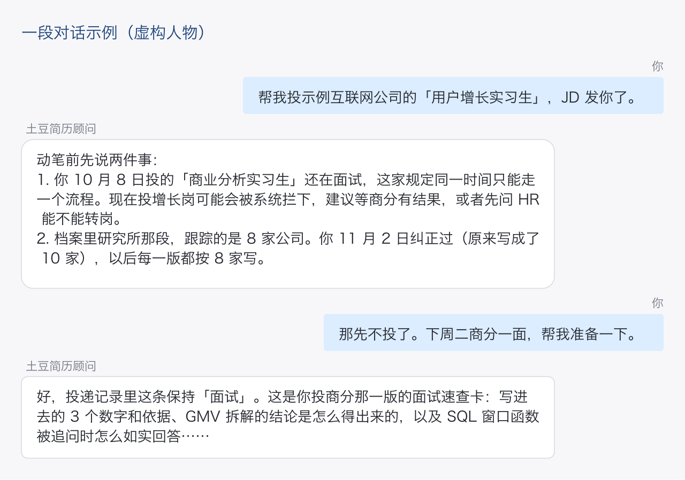
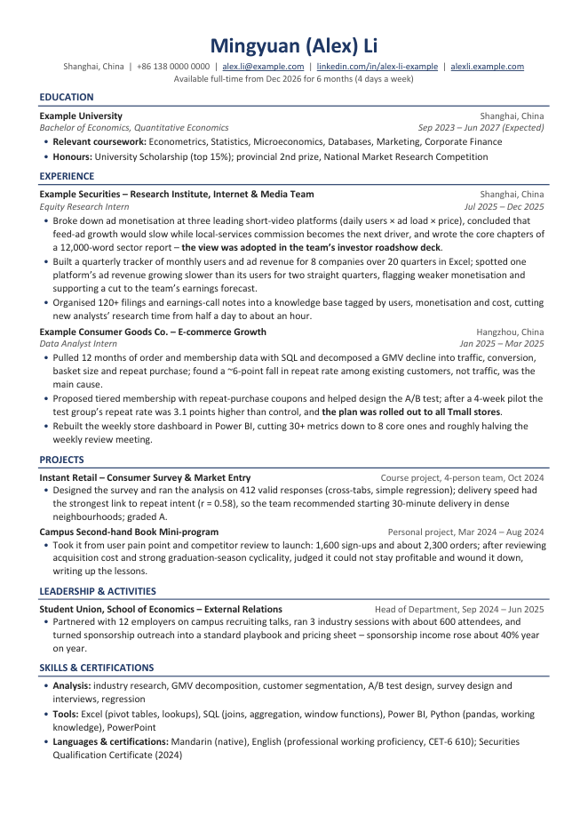
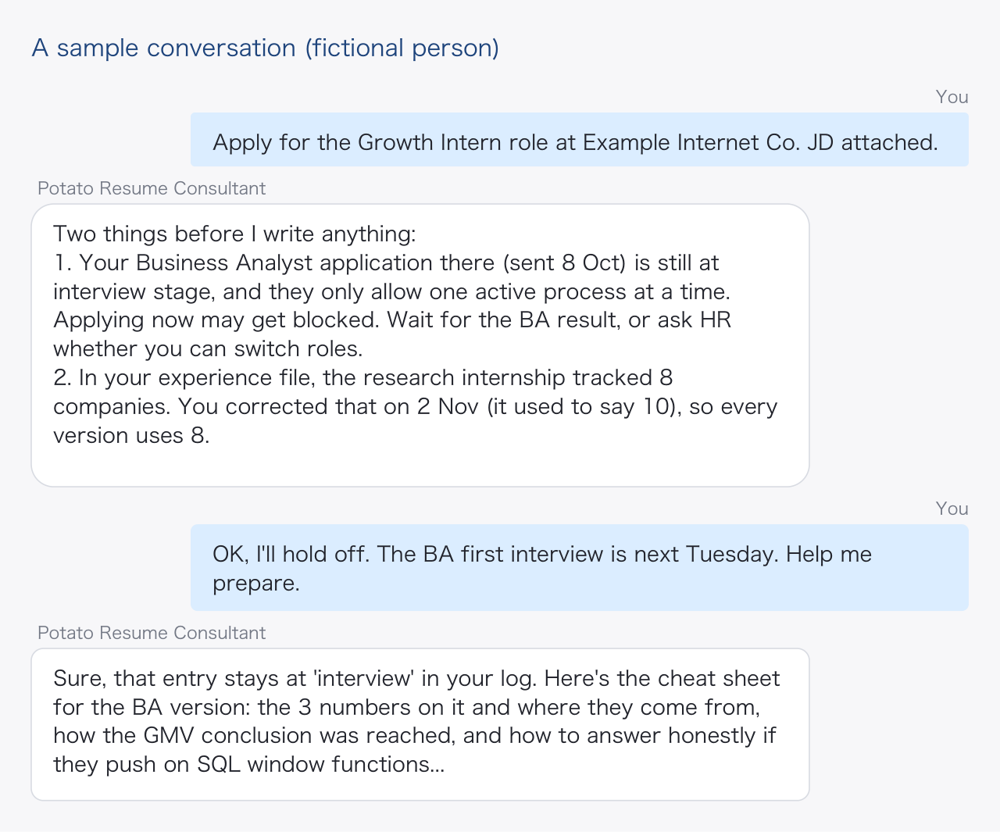

# 土豆简历顾问 · 把你的 AI 变成专属求职顾问

[English](#english) · 中文

用 AI 改简历，每次都得重新解释一遍自己是谁，改出来满篇空话，缺数字还会顺手编一个，面试官一追问就露馅。报求职陪跑，动辄几千块，一个顾问同时带很多人，未必记得你每段经历的细节。这个 skill 换了个思路：一次建好你的经历档案，你自己的 AI 就成了只服务你、越用越懂你的求职顾问。

> 我是一个正在找实习的大学生，自己用这套流程改了 50 多份简历。之前做过一个 AI 改简历网站，后来发现连我自己都不用：它每次都从零开始，不记得我是谁。所以做了这个。

Claude、ChatGPT / Codex、Cursor、GitHub Copilot、Gemini CLI 等都能用，Windows、macOS、Linux 都支持，[安装](#安装)只要把一句话发给你的 AI。装好后的 skill 名是 `resume-tailor`，对 AI 说“用土豆简历顾问”或“用 resume-tailor”都行。

<p align="center"></p>

## 它像顾问，不像工具

**记得你。** 经历档案存在你自己的电脑上：哪段能写、哪段只能怎么写、哪段永远不写，哪个数字被你纠正过，它都记着。换一个对话也不用重讲。第一次多回答几个问题，之后越用越快。

**先判断，再动笔。** 每个 JD 先查你够不够格：届别、地点、到岗时间、签证、这家公司的投递限制。再从你的全部经历里挑最能打的几段，用这个行业看重的逻辑来写。够不上或者胜算不大，它会直说。

**替你守底线。** 不编经历，不编数字。每句话都拆成面试官会追问的小问题：你是主导还是参与？这个数字是团队的还是你个人的？已经上线还是还在规划？站不住的就改到站得住。

**陪你打完整个求职季。** 每次投递都记进投递记录：投了哪家、用的哪版简历、走到哪一步、这家有什么投递限制。在用它的对话里说一句“XX 约面了”，它就更新；再投同一家时，它会先提醒你。同一个方向认真改过一版之后，后面的同类岗位可以快投，越投越快。

还没准备好建档案？说“帮我体检这份简历”，发一份现成简历和 JD，先拿一页体检报告：每句话会被怎么追问、哪里有夸大风险、JD 关键词漏了哪些。

## 和普通 AI、付费求职陪跑比

| | 普通 AI 改简历 | 付费求职陪跑 | 这个 skill |
|---|---|---|---|
| 价格 | 看你用哪个 AI，有免费的 | 动辄几千块 | skill 免费开源，用你已有的 AI |
| 懂不懂你的全部经历 | 只看你这次贴进来的 | 看顾问的精力，带的人多时未必记得细节 | 档案里有你的全部经历、红线和纠正记录 |
| 随叫随到 | 是 | 按约好的时间 | 是，半夜改简历也行 |
| 会不会编 | 缺数字容易编一个 | 一般不会 | 不编，每句话按面试官的追问核查 |
| 换个岗位要不要重讲 | 新对话就得重讲 | 一般不用 | 不用，它先读档案 |
| 能不能帮你判断值不值得投 | 一般拿到就写 | 能，还有行业经验 | 先查资格、挑经历，不合适会直说 |

陪跑也有这个 skill 给不了的东西：真人的行业经验、人脉和内推。需要这些的话，陪跑值得考虑；这个 skill 帮你把简历和投递这部分做扎实。

## 同一段经历，投不同岗位怎么写

经历档案里的一段真实经历（虚构示例）：*在券商研究所互联网传媒组实习，跟踪 8 家平台 20 个季度的月活和广告收入，写了短视频广告行业报告的一章。*

| | 写法 |
|---|---|
| ❌ 普通 AI | 负责行业研究工作，协助撰写行业报告，助力团队决策，大幅提升工作效率。 |
| ✅ 投券商 / 投研 | 搭建 8 家平台、20 个季度的月活与广告收入跟踪表，发现某平台广告收入增速连续两个季度低于用户增速，提示商业化效率下滑，支持组内调低盈利预测。 |
| ✅ 投互联网商分 / 战略 | 拆解短视频平台广告变现链路（日活 × 广告加载率 × 单价），判断信息流广告增速将放缓、本地生活佣金成为新增量，观点被组长采纳进对外路演材料。 |

两版的数字和结论都来自同一段经历的真实细节，只是换成了对方行业看重的逻辑：券商看**判断和预测**，互联网看**变现和增长**。经历档案里没有的数字和结论，它会先问你，不会替你编。

## 它还会帮你做的事

- **先写后学**：JD 要的技能，1 天到 1 周能上手的先写上，用词实诚（"熟悉"，不写"精通"），要时给你速成清单：学习路线、练手项目、面试题。
- **一页写满，过得了机筛**：固定模版出 Word 和 PDF，不溢出、不留白；交付前自动检查板块标题、字号、页边距、PDF 能否被正确读取和 JD 关键词覆盖。
- **面试速查卡**：接到面试说一声，给你这一版写了哪些数字、依据是什么、结论怎么来的、新技能被问到怎么如实回答。
- **网申纯文本**：要填网申时说一声，按北森、Moka、Workday 等表单的字段排好，日期统一，直接粘贴。
- **快投**：同一个方向认真改过一版后，说"快投"就直接出稿，取舍在交付时说明。

做出来的简历长这样：

<p align="center">
  
  
</p>
<p align="center"><sub>示例简历里的人物、学校、公司、数字都是虚构的。</sub></p>

## 安装

### ⚡ 最省事：把这句话发给你的 AI（推荐）

适用于能在你电脑上运行命令的 AI：Claude Code、Codex、Cursor、GitHub Copilot、Gemini CLI 等。

> 帮我安装这个 skill：https://github.com/Potatokid830/ultimate-resumetailor 。把它下载到你的 skills 文件夹里，文件夹命名为 resume-tailor，装好它需要的依赖，然后按我发给你的 JD 帮我改简历。

它会自己下载、放到正确的位置、装好 Python 和 PDF 转换工具（装之前会问你），然后按 JD 开始帮你改，需要的经历边改边问你。

### 手动安装

1. 点页面上方绿色的 **Code → Download ZIP**，下载后解压，把文件夹名改成 `resume-tailor`。
2. 把文件夹交给你用的 AI：
   - **Claude.ai / Claude 桌面版**：在 Settings → Capabilities → Skills 上传这个 zip。ChatGPT 等其他应用按 [agentskills.io 名单](https://agentskills.io/clients) 里该应用的 "Setup instructions" 操作。
   - **Claude Code、Codex、Copilot、Cursor、Gemini CLI 等编程工具**：放进它的 skills 文件夹。Claude Code 是 `~/.claude/skills/`（Windows 上是 `C:\Users\你的用户名\.claude\skills\`）；很多工具也认通用位置 `~/.agents/skills/`；各工具的具体位置见 [agentskills.io 名单](https://agentskills.io/clients) 里的 "Setup instructions"。
   - **其他 AI**（不支持 skill 的）：把文件夹放在 AI 能读到的地方，对它说"读 `resume-tailor/SKILL.md`，按里面的流程帮我改简历"。
3. 对 AI 说："用 resume-tailor 帮我改简历"。

### 第一次用：不用对着空白模版填

第一次使用时如果你带着 JD 来，AI 会先做资格核查（届别、地点、到岗时间、签证），确认能投再往下走。然后它会检查你的电脑还缺什么（Python，以及 Word / WPS / LibreOffice 其中一个用来转 PDF），征得你同意后帮你装好。然后你只要**把手头的材料一股脑发给它**：旧简历（写得再烂也行）、LinkedIn、实习周报、课程报告、项目文档。它会全部读一遍、拆成经历档案初稿。你带着 JD 来的话，它只让你确认这份 JD 要用的那几条（一般不超过 10 条），其余先标成"待确认"存着，等哪份 JD 用到再问你；只想建库的话才逐条确认。只想先体检一份简历的话，这一步可以跳过。如果它有记忆功能，还会把记忆里你提过的经历一起整理进来给你确认。你不需要自己敲任何命令。

> 出 docx / pdf 需要 AI 能在你电脑上（或它自己的沙盒里）运行命令。只能聊天、不能运行命令的 AI 也能走完整个流程（资格核查、选材、改写、HR 挑刺、速查卡、网申纯文本），只是最后要你自己把文字贴进 `assets/` 里的空白模版。

## 支持哪些 AI 工具

这个 skill 用的是 [Agent Skills](https://agentskills.io) 开放格式（一个文件夹，里面有 `SKILL.md` 和脚本），不只 Claude 能用。按 [agentskills.io 官方名单](https://agentskills.io/clients)，支持这个格式的常见工具有：

- **Claude**：Claude.ai、Claude 桌面版、Claude Code
- **OpenAI**：ChatGPT、Codex
- **GitHub Copilot / VS Code**
- **编程工具**：Cursor、TRAE、Kiro、Roo Code、JetBrains Junie、Amp、OpenCode、Goose、OpenHands、Factory、Tabnine 等
- **Google Gemini CLI**、**Mistral Vibe**、**Letta**、**OpenClaw**

名单在持续增加，以官网为准。不在名单上的 AI 也能用，见上面手动安装里的"其他 AI"。

## 更新到新版本

最简单：直接对你的 AI 说

> 帮我把 resume-tailor 这个 skill 更新到 https://github.com/Potatokid830/ultimate-resumetailor 的最新版，保留我的 profile.json、materials.md 和照片。

<details>
<summary>手动更新的三种方式</summary>


自己更新的话，按当初的安装方式：

- **下载 ZIP 放进文件夹的**（Claude Code、Codex、Cursor 等）：重新 **Code → Download ZIP** 并解压，把新文件复制进旧的 `resume-tailor` 文件夹、覆盖同名文件。新压缩包里不含 `profile.json`、`materials.md` 和照片，所以覆盖是安全的；**不要先删掉整个旧文件夹**，否则个人文件会一起丢。
- **用 git clone 下载的**：在 skill 文件夹里运行 `git pull`。个人文件不受 git 管理，不会被动到。
- **在 Claude.ai / 桌面版设置里上传 zip 的**：在 Settings → Capabilities → Skills 里删掉旧版，重新上传新 zip。如果当初把 `materials.md` 打包进了 zip，上传前先把它放进新 zip。

新版本会沿用你原来的 `profile.json` 和 `materials.md`，不需要重新填。

</details>

## 使用流程

对 AI 说："用 resume-tailor 帮我按这个 JD 改简历"，并贴上 JD。有三种模式：

- **🩺 简历体检**：说"帮我体检这份简历"，发一份现成简历（最好带上 JD）。不用建经历档案，也不改写，直接给一页体检报告：总评和最该先改的 3 件事；拆出多少个主张、几个站得住、几个要准备、几个有夸大风险；JD 关键词覆盖率；逐条写出面试官会怎么追问、建议怎么改。报告里不写你的联系方式，要截图分享时还可以把公司和学校名换成泛称。体检时你确认过的事实，以后直接作为经历档案初稿。
- **精修模式**（默认）：第一次投某个方向、冲刺最想去的公司时用。选材和缺的细节都会先问你。
- **⚡ 快投模式**：说"快投""海投""直接出稿"，或一次贴好几个 JD。不再等你确认选材，直接按经历档案出稿，交付时说明自动做了哪些取舍。它只用你标了 ✅ 的内容，不编数字、不加你没同意过的新技能；资格核查照做，不过的会单独停下来问你。每个方向第一次投时，那一份会先走精修模式和你确认选材，记进经历档案后，同方向的岗位就能直接快投。一次贴多个 JD 时，每份放在单独的文件夹里，对话里只给一张汇总表，要哪几份的速查卡或网申文本再说。

完整流程：

1. **资格核查**：届别、地点、到岗时间、签证、成绩门槛、投递数量限制，并查你的投递记录：这家公司有没有正在走的流程、有没有冷却期。有不过的先告诉你。
2. **回顾全部经历**：把 `materials.md` 整份过一遍，按 JD 挑出最相关的。整份读、按需确认：只有这份 JD 要用、还没确认过的条目才问你。如果你的 AI 有记忆功能，它也会查记忆里有没有经历档案还没收录的经历、数字或更正，这份 JD 要用的给你确认，其余存成待确认。
3. **先问再写**：列出"放哪些、每段写什么角度、哪些不放及原因"，等你确认（快投模式跳过）。
4. **缺细节就追问**：只有你知道的数字和反馈，直接问你（快投模式不问，缺的不写，交付时列出来）。
5. **技能对齐 JD**：短期能学会的先写上，要速成清单时说一声。
6. **写稿，先审文字**：先出纯文字稿，做逐句拆解核查（每条要点拆成能核实的小主张，在经历档案里找出处，有夸大风险的改到站得住）和 HR 挑刺；有旧简历时，新旧两版逐项对比，新版不能在任何一项上输给旧版。文字定稿后才排版，省得反复重压一页。
7. **排版出稿 + 机筛自检**：一页 docx + pdf，一页写满；`ats_check.py` 检查板块标题、联系方式、字号、页边距、表格/文本框、文档属性、PDF 可解析性、底部留白、AI/Al 这类拼写和 JD 关键词覆盖。
8. **交付**（交付后自动记进投递记录 `applications.md`；之后在用它的对话里说"XX 约面了""XX 拒了"，它会更新状态）：
   - 默认：docx + pdf，加一张短交付表：选了什么、没选什么、哪些技能要补、机筛结果、能不能拿面试的坦白评价
   - 按需（说"要投了""要填网申""接到面试了"时再生成）：
     - **面试速查卡**：这一版写的每个数字和依据、每个结论是怎么分析出来的、"先写后学"技能怎么如实回答、和其他版本差在哪
     - **网申纯文本**：按网申表字段排好的教育、经历、项目、技能，日期统一成 `2025-07` 格式，没有项目符号和粗体，直接粘贴
     - **速成清单**：每个"先写后学"技能的学习路线、练手项目和面试题
   - 按需生成的内容存成和简历同名的 `.notes.md`，以后接到面试电话翻出来就行

## 目录结构

<details>
<summary>展开目录</summary>

```
resume-tailor/
├── SKILL.md                 # skill 本体:流程、三种模式(体检/精修/快投)、逐句核查、包装与编造的边界、行业翻译、先写后学、模版规则
├── profile.example.json     # 个人信息配置示例(虚构)→ 复制成 profile.json
├── materials.example.md     # 经历档案模版 + 填写说明 → 复制成 materials.md
├── applications.example.md  # 投递记录模版(虚构示例)→ 复制成 applications.md
├── assets/
│   ├── template_cn.docx     # 中文空白模版(占位符)
│   └── template_en.docx     # 英文空白模版(占位符)
├── scripts/
│   ├── build.py             # 一条命令:docx → pdf → 预览图 → 机筛自检(Windows / macOS / Linux 通用)
│   ├── build.sh             # 旧用法的转发脚本
│   ├── core.py              # 读模版和 profile.json,finish() 写文档属性
│   ├── helpers_cn.py        # 中文积木:header / section / entry / sub / bullet
│   ├── helpers_en.py        # 英文积木(Calibri,标题大写)
│   ├── ats_fix.py           # 自动补"预计/Expected"、修页边距
│   ├── ats_check.py         # 机筛自检 + JD 关键词覆盖
│   ├── fit_report.py        # 一页压不下 / 留白时:差几行、删哪几个字最省事
│   ├── addphoto.py          # 可选证件照
│   └── pdf_tools.py         # 转 PDF(LibreOffice / Word)、页数、预览图
├── examples/
│   ├── example_cn.py        # 虚构人物中文示例(互联网商分)
│   ├── example_en.py        # 虚构人物英文示例(strategy / business analyst)
│   └── photo_example.jpg    # 占位头像
├── docs/                    # README 用的示例截图和 PDF
└── tools/
    └── package_workbuddy.py # 打包上传 WorkBuddy 用的 zip(维护者用,改简历用不到)
```

</details>

## 隐私

- **存在哪**：你的档案（`profile.json`、`materials.md`、`applications.md`）、照片、生成的简历、`.notes.md` 和体检报告都存在你自己的电脑上（或你用的 AI 的沙盒里），都在 `.gitignore` 里，不会被提交到 GitHub。
- **对话内容**：你发给 AI 的简历、经历和 JD，会按你所用 AI 服务（Claude、ChatGPT、Codex、WorkBuddy 等）的隐私政策处理。这个 skill 管不了平台怎么存对话，介意的话先看一下所用平台的说明。
- 个人内容只放这三份档案，不要写进 `SKILL.md`，这样 skill 可以放心更新和分享。

## License

[MIT](LICENSE)

---

## English

**Potato Resume Consultant: turn your AI into your own career consultant**

Using AI on your resume usually means explaining who you are all over again, getting back vague filler, and sometimes a number it simply made up, which falls apart the first time an interviewer asks about it. Paid career coaching costs a lot, and a coach juggling many clients may not remember the details of every role you've had. This skill takes a different route: build your experience file once, and the AI you already use becomes a consultant that works only for you and knows you better every time.

> I'm a university student looking for internships, and I've tailored more than 50 resumes with this process. I once built an AI resume website, then realised I didn't use it myself: it started from zero every time and never remembered who I was. So I built this instead.

Works with Claude, ChatGPT / Codex, Cursor, GitHub Copilot, Gemini CLI and more, on Windows, macOS and Linux. To [install](#install), send one sentence to your AI; once installed, the skill is called `resume-tailor`, and "use Potato Resume Consultant" or "use resume-tailor" both work.

<p align="center"></p>

### A consultant, not a tool

**It remembers you.** Your experience file lives on your own computer: which roles can go on a resume, which only in a certain way, which never, and every number you've corrected. Start a new conversation and you don't have to explain yourself again. The first session takes a few more questions; after that it gets faster.

**It judges before it writes.** Every JD starts with an eligibility check: graduation year, location, start date, visa, and any application rules at that company. Then it picks your strongest experiences from everything you've done and writes them the way that industry thinks. If you don't qualify, or the odds look poor, it tells you plainly.

**It keeps you honest.** No invented experience, no invented numbers. Every line is broken into the questions an interviewer would ask: did you lead it or take part? Is that number the team's or yours? Did it launch, or is it still a plan? Anything that wouldn't survive the question gets rewritten until it would.

**It stays with you for the whole season.** Each application goes into a log: the company, the resume version you sent, where it stands, and any rules that company has. Say "X invited me to interview" in a conversation where you're using it, and it updates the log; apply to the same company again and it warns you first. Once you've carefully tailored one version for a direction, similar roles can go through quick mode, so each application is faster than the last.

Not ready to build a file yet? Say "check up this resume" and send an existing resume plus the JD. You get a one-page report on how an interviewer would probe each line, where you risk overstating, and which JD keywords are missing.

### Compared with a regular AI chat and paid career coaching

| | Regular AI chat | Paid career coaching | This skill |
|---|---|---|---|
| Cost | Depends on the AI; some are free | Often a lot | The skill is free and open source; you use the AI you already have |
| Knows your full background | Only what you paste this time | Depends on the coach's bandwidth | Your file holds every experience, red line and correction |
| Available whenever you need it | Yes | At booked times | Yes, even at 2 a.m. |
| Makes things up | Tends to invent missing numbers | Usually not | No; every line is checked against likely interview questions |
| Re-explaining yourself for a new role | Every new chat | Usually not | No; it reads your file first |
| Tells you whether a role is worth it | Usually just starts writing | Yes, with industry experience | Checks eligibility and picks experiences first, and says so if it's a poor fit |

Career coaching does offer things this skill can't: a real person's industry experience, a network, and referrals. If you need those, coaching is worth considering; this skill makes sure your resume and applications are solid.

### One experience, written for two different jobs

A real entry from your experience file (fictional example): *intern in a brokerage research team covering internet and media; tracked monthly users and ad revenue for 8 platforms over 20 quarters; wrote one chapter of a short-video advertising report.*

| | Bullet |
|---|---|
| ❌ Typical AI | Responsible for industry research, assisted with industry reports, supported team decision-making and greatly improved efficiency. |
| ✅ For equity research / banking | Built a tracker of monthly users and ad revenue for 8 platforms over 20 quarters; flagged one platform whose ad revenue grew slower than its user base for two straight quarters, supporting the team's cut to its earnings forecast. |
| ✅ For tech strategy / business analysis | Broke down short-video ad monetisation (DAU × ad load × price); concluded feed-ad growth would slow and local-services commission would be the next driver, a view the team lead adopted for client roadshow materials. |

Both versions use the same real numbers and conclusions; only the logic changes to what each industry values: research cares about **calls and forecasts**, tech cares about **monetisation and growth**. If a number or conclusion isn't in your bank, it asks you instead of making one up.

### What else it does

- **List now, learn fast**: JD skills you can pick up in a day to a week go on the resume, worded honestly ("familiar with", never "expert"), with a crash-course plan when you ask: learning route, practice project and likely interview questions.
- **One full page that gets past the screen**: a fixed template in Word and PDF, no overflow and no empty space at the bottom; before delivery it checks section headings, font sizes, margins, whether the PDF text reads correctly, and JD keyword coverage.
- **Interview cheat sheet**: got an interview? Ask, and you get the numbers in that version, where they come from, how each conclusion was reached, and how to answer honestly about new skills.
- **Form-ready plain text**: filling in an online form? Ask, and you get your details laid out by the usual fields (Workday, company career sites and so on), with consistent dates, ready to paste.
- **Quick mode**: once you've carefully tailored one version for a direction, say "quick mode" and it builds straight away, explaining its choices at delivery.

The finished resume looks like this:

<p align="center">
  
  
</p>
<p align="center"><sub>Fictional person: every school, company and number is made up.</sub></p>

### Install

#### ⚡ Easiest: send this to your AI (recommended)

For AIs that can run commands on your computer: Claude Code, Codex, Cursor, GitHub Copilot, Gemini CLI and others.

> Install this skill for me: https://github.com/Potatokid830/ultimate-resumetailor. Download it into your skills folder as a folder named resume-tailor, install whatever it needs, then tailor my resume to the JD I'm sending you.

It downloads the skill, puts it in the right place, installs Python and a PDF converter (asking you first), and starts on your resume for that JD, asking about your experience as it goes.

#### Manual install

1. Click the green **Code → Download ZIP** button above, unzip it, and rename the folder to `resume-tailor`.
2. Give the folder to your AI:
   - **Claude.ai / Claude desktop**: upload the zip under Settings → Capabilities → Skills. For ChatGPT and other apps, follow that app's "Setup instructions" on the [client list](https://agentskills.io/clients).
   - **Claude Code, Codex, Copilot, Cursor, Gemini CLI and other coding agents**: put the folder in the agent's skills folder. For Claude Code that is `~/.claude/skills/` (on Windows, `C:\Users\<you>\.claude\skills\`); many agents also read the shared location `~/.agents/skills/`.
   - **Any other AI** without skill support: put the folder somewhere it can read and say "Read `resume-tailor/SKILL.md` and follow it to tailor my resume".
3. Say: "Use resume-tailor to tailor my resume."

#### First use: no blank template to fill in

If you bring a JD on first use, the AI checks your eligibility first (graduation year, location, start date, visa) so you don't set everything up for a role you can't apply to. Then it checks what your computer is missing (Python, plus Word, WPS or LibreOffice to make the PDF) and installs it with your permission. Then just **send it everything you have**: old resumes (however rough), your LinkedIn, internship reports, coursework, project documents. It reads everything and turns it into a draft experience file. If you came with a JD, you only confirm the items that JD needs (usually no more than 10); the rest are saved as "to confirm" and asked about when a later JD needs them. Only if you just want to build the bank does it go through every item. If you only want a check-up first, you can skip this. If it has memory, it also pulls in what you've already told it, for you to confirm. You don't need to type any commands yourself.

> Producing the docx / pdf requires an AI that can run commands on your computer (or in its own sandbox). A chat-only AI can still run the whole process (eligibility check, selection, rewriting, recruiter critique, cheat sheet, form text); you then paste the text into the blank template in `assets/` yourself.

### Supported AI tools

Any agent that supports the open [Agent Skills](https://agentskills.io) format (a folder with `SKILL.md` and scripts) can use it. According to the [official client list](https://agentskills.io/clients), that includes:

- **Claude**: Claude.ai, Claude desktop, Claude Code
- **OpenAI**: ChatGPT, Codex
- **GitHub Copilot / VS Code**
- **Coding agents**: Cursor, TRAE, Kiro, Roo Code, JetBrains Junie, Amp, OpenCode, Goose, OpenHands, Factory, Tabnine and more
- **Others**: Google Gemini CLI, Mistral Vibe, Letta, OpenClaw

The list keeps growing; check the website for the latest. Agents without skill support can still use it (see "Any other AI" under Manual install).

### Updating to a new version

Easiest: ask your AI

> Update the resume-tailor skill to the latest version from https://github.com/Potatokid830/ultimate-resumetailor, and keep my profile.json, materials.md and photo.

<details>
<summary>Updating by hand</summary>


To update by hand, follow the way you installed it:

- **Downloaded the ZIP into a skills folder** (Claude Code, Codex, Cursor and so on): download and unzip the new ZIP, then copy the new files into your existing `resume-tailor` folder, overwriting files with the same name. The new ZIP doesn't contain `profile.json`, `materials.md` or your photo, so overwriting is safe. **Don't delete the old folder first**, or your personal files go with it.
- **Cloned with git**: run `git pull` inside the skill folder. Your personal files aren't tracked by git, so they stay untouched.
- **Uploaded the zip in Claude.ai / desktop settings**: remove the old version under Settings → Capabilities → Skills and upload the new zip. If you had packed `materials.md` into your zip, add it to the new zip before uploading.

New versions keep using your existing `profile.json` and `materials.md`; you don't need to fill them in again.

</details>

### How a session goes

Say "Use resume-tailor to tailor my resume for this JD" and paste the job description. There are three modes:

- **🩺 Resume check-up**: say "check up this resume" and send an existing resume (ideally with the JD). No experience file and no rewriting: you get a one-page report with an overall verdict and the top 3 fixes; how many claims were found and how many hold up, need preparation or risk overstating; JD keyword coverage; and, line by line, how an interviewer would probe it and how to fix it. The report leaves out your contact details and can swap company and school names for generic ones if you want to share a screenshot. Facts you confirm during the check-up become the first draft of your experience file.
- **Polish mode** (default): for the first application in a direction or a company you really want. It asks you about selection and missing details first.
- **⚡ Quick mode**: say "quick mode", "mass apply" or "just build it", or paste several JDs at once. It skips waiting for your OK on selection, builds from your bank, and explains its choices at delivery. It only uses items you marked ✅, never invents numbers and never adds new skills you haven't approved; the eligibility check still runs, and any JD that fails it is paused for you. The first application in a new direction goes through polish mode so you can confirm the selection; once it is saved in your bank, later roles in that direction go straight through. With several JDs, each gets its own folder, the chat shows one summary table, and you ask for whichever cheat sheets or form text you need.

The full process:

1. **Checks eligibility**: graduation year, location, start date and duration, visa, GPA cut-offs, application limits, plus your application log: any process already running at this company, or a cooling-off period. Anything that fails is raised first.
2. **Reviews your whole experience file** in `materials.md` and picks what fits the JD best. It reads everything but only asks about unconfirmed items this JD needs. If your AI has memory, it also checks memory for experiences, numbers or corrections the bank is missing; the ones this JD needs go to you for confirmation, the rest are saved as "to confirm".
3. **Asks before writing**: lists what goes in, the angle for each item, and what stays out and why, then waits for your OK (skipped in quick mode).
4. **Asks for missing details**: numbers and feedback only you know; it never guesses (in quick mode it leaves them out and lists them at delivery).
5. **Aligns skills with the JD**: adds skills you can learn quickly; ask for a crash-course plan when you want one.
6. **Writes and reviews the text first**: a plain-text draft goes through the claim-by-claim audit (each bullet split into checkable claims, matched to your bank, anything overstated fixed) and a recruiter critique; if you gave it an old resume, the two are compared side by side and the new one must not be worse on any point. Layout only starts once the text is final, so the page isn't squeezed again and again.
7. **Lays it out + ATS self-check**: one full page, docx + pdf; `ats_check.py` checks section headings, contact details, font sizes, margins, tables/text boxes, document properties, PDF text extraction, empty space at the bottom, typos such as "Al" for "AI", and JD keyword coverage.
8. **Delivers** (and logs the application in `applications.md`; later, in a conversation where you're using it, say "X invited me to interview" or "X rejected me" and it updates the status):
   - By default: docx + pdf, plus a short delivery table: what was included, what was left out, which skills to learn, the ATS result, and an honest view of your interview chances
   - On request (say "I'm applying", "I need to fill in the form" or "I got an interview"):
     - **Interview cheat sheet**: every number in this version and its basis, how each conclusion was reached, honest answers for "list now, learn fast" skills, and how this version differs from your others
     - **Form-ready plain text**: education, experience, projects and skills laid out by the usual form fields, dates as `2025-07`, no bullets or bold, ready to paste
     - **Crash-course plan**: learning route, practice project and likely interview questions for each "list now, learn fast" skill
   - Anything generated on request is saved next to the resume as `<file name>.notes.md`, so you can pull it up when an interviewer calls

### Your data

- **Where it lives**: your files (`profile.json` for your details, `materials.md` for your experiences, `applications.md` for your applications), your photo, every generated resume, the `.notes.md` files and check-up reports stay on your own computer (or in your AI's sandbox). They are all in `.gitignore`, so they are never committed to GitHub.
- **Your conversations**: the resume, experiences and JDs you send are handled under the privacy policy of the AI service you use (Claude, ChatGPT, Codex, WorkBuddy and so on). This skill has no control over how a platform stores conversations, so check its policy if that matters to you.
- Keep personal content out of `SKILL.md`, so the skill itself can be updated and shared safely.

### Folder structure

See the [directory tree above](#目录结构): `SKILL.md` (the workflow), `profile.example.json`, `materials.example.md` and `applications.example.md` (templates you copy), `assets/` (blank Chinese and English templates), `scripts/` (build, ATS check, PDF export) and `examples/` (fictional sample builds).

### License

[MIT](LICENSE)
